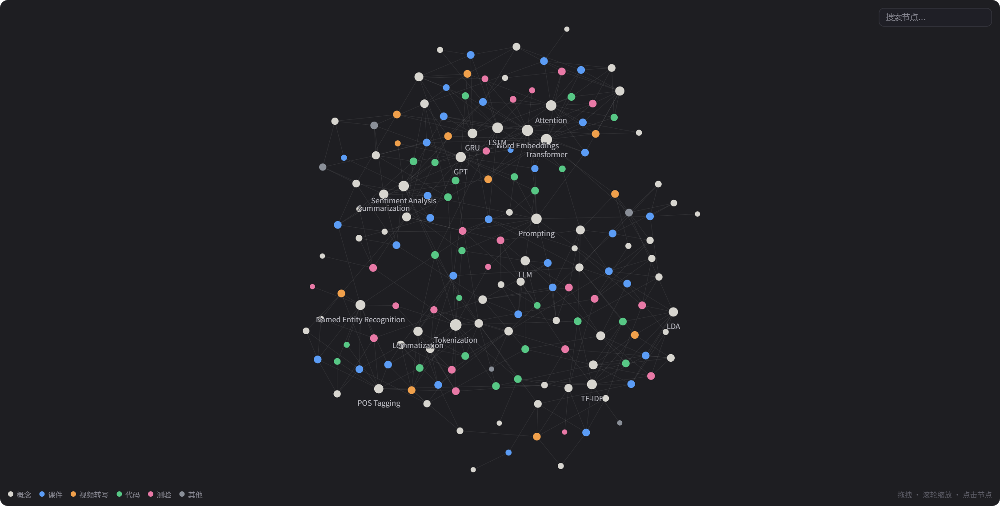
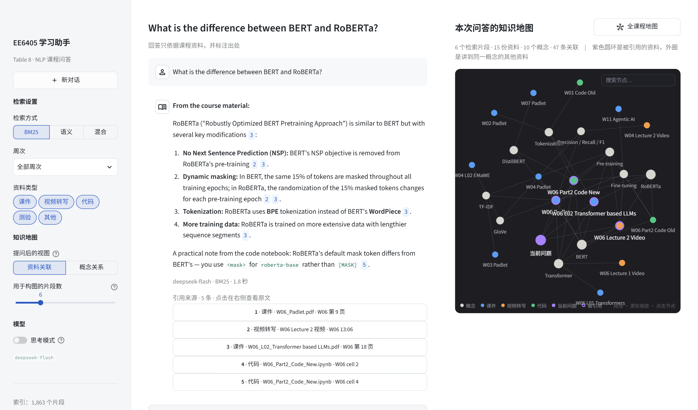
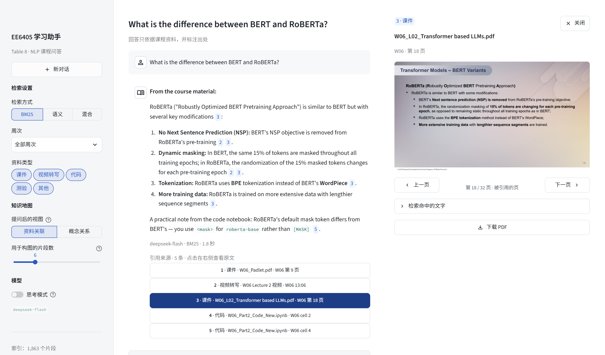
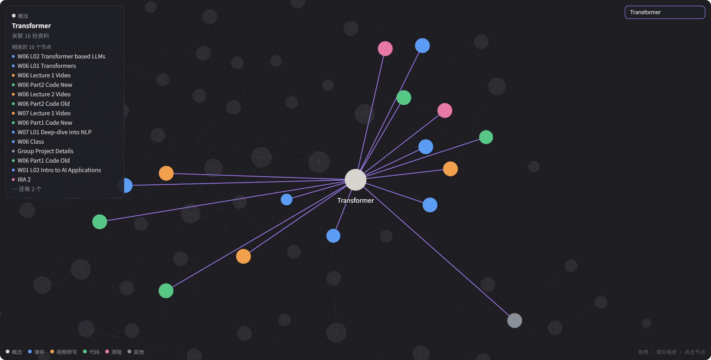
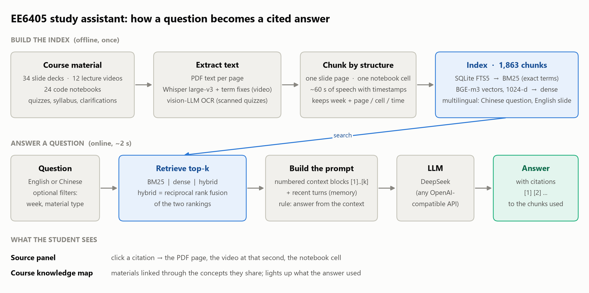
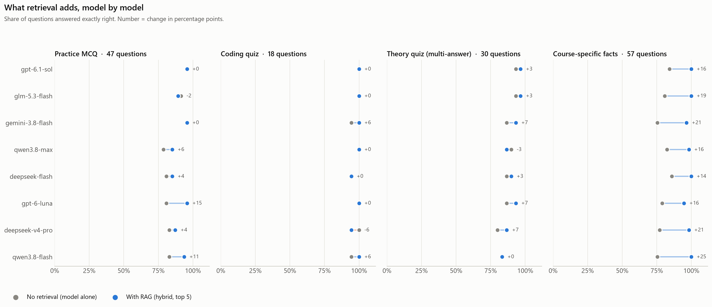
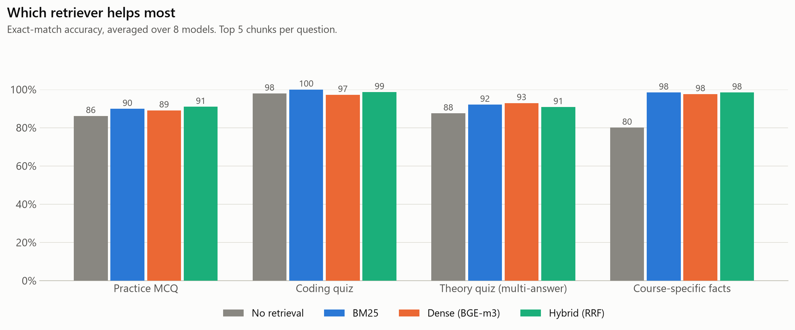
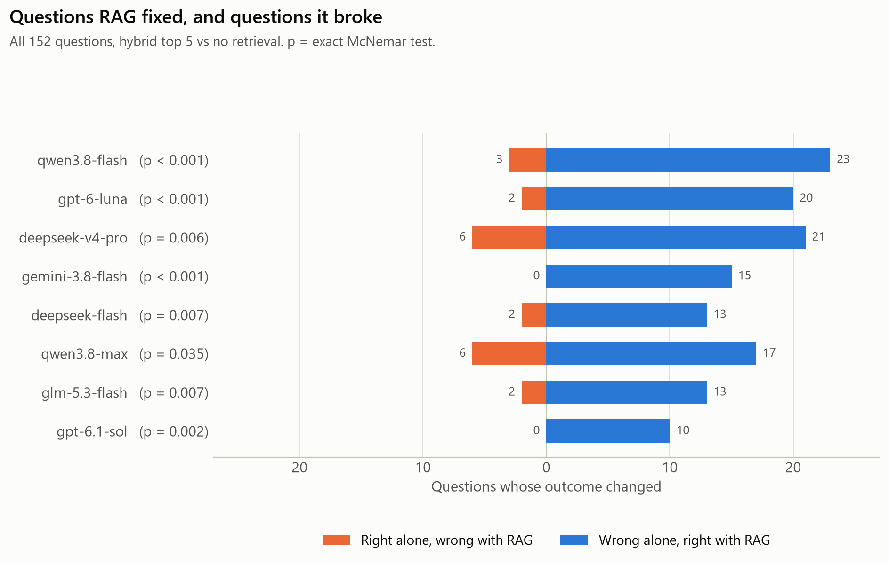

# EE6405-TABLE8

这是EE6405的课程项目仓库，使用GitHub来管理项目以方便小组合作和向Prof解释我们每个人在小组项目中的贡献

v10.30.1
# 0. 项目一览 ✨

**EE6405 学习助手**：一个面向 NTU EE6405（自然语言处理）课程的 RAG 问答助手。
它依据检索到的课程资料回答，回答里的引用可以点回原文，并把课程资料和概念连成一张可以探索的知识地图。

<em>课程知识地图：95 份课程资料与 68 个概念，资料通过共同涉及的概念相连</em>

## 它能做什么

| | |
| --- | --- |
| **有出处的回答** | 检索 1,863 个课程片段（课件、视频转写、代码、测验），回答里的 `[n]` 对应具体的页码、时间点或代码单元格 |
| **三种检索方式** | BM25、语义（BGE-m3）、混合（RRF）；中文提问也能检索英文课件 |
| **点开就是原文** | 课件显示 PDF 的那一页，视频跳到那一秒，notebook 滚动到那个单元格 |
| **知识地图** | 提问后地图切换到本次问答的视角：问题 → 被引用的资料 → 概念 → 讲到同一概念的其他资料 |

## 界面

<em>左：带引用的回答。右：本次问答的知识地图，紫色圆环是被引用的资料</em>

<em>点击引用，右侧打开被引用的那一页课件</em>

<em>搜索或点击一个概念，高亮所有讲到它的资料</em>

## 系统流程

## 评测结果

在 4 个测试集（共 152 题）上，对比 8 个模型"不检索"和"用我们的 RAG"的答题正确率：
**所有模型都有提升，平均从 85.5% 到 94.7%**，每个模型的差异都通过了 McNemar 检验。

| | |
| --- | --- |
|  |  |

提升主要来自课程专属内容（80% → 98%）；通用 NLP 知识模型本来就会，在读代码的题上几乎没有差别。
RAG 也会把少数原本答对的题改错。完整的方法、结果和局限见 [`docs/EVALUATION.md`](docs/EVALUATION.md)。

---

# 1. 如何使用这个项目🚀

**统一在本仓库开分支协作，不用 fork。** 需要 push 权限的话，找组长把你加成 collaborator。

1. 克隆仓库

~~~bash
git clone https://github.com/hiGhbYte29/EE6405-TABLE8.git
cd EE6405-TABLE8
~~~

2. 从 `main` 开一个自己的分支，分支名用自己的名字

~~~bash
git checkout -b <你的名字> main
~~~

3. 提交后 push 到同名分支，再从该分支向 `dev` 提 PR

~~~bash
git push -u origin <你的名字>
~~~

> `main` 和 `dev` 都不要直接 push，`main` 由组长从 `dev` 合并。
> 要在已有的 RAG 代码上做开发，见下面第 3 节的部署说明。

# 2. Project Detail📖

详见课程ppt：目录
~~~
/Group project detail
~~~

### 2.1. 与分配给你的组员合作

- 请参照课程大纲中的评分细则了解具体要求，例如：使用 **Streamlit** 添加前端界面，完善最终作品。
- **第 12 周安排项目咨询**：请带上草稿或初步想法。
- **组员互评**：稍后将在 **NTULearn** 上发布。**每个人都必须完成，否则将扣除 5% 的成绩。**
- **截止时间：11 月 15 日（周日）晚上 11:59。**

### 2.2. 以下内容均可自行选择（可以扩展课堂活动，也可以开展新项目）

- **NLP 应用**：例如文本摘要、聊天机器人、情感分析、翻译等。
- **数据集**：建议使用 **3 个或更多数据集**进行比较。
- **算法与超参数**：用于特征提取和／或计算处理。
- **性能评价指标**：用于评估方法的效果。
- **基线论文（可选）**：选择会议或期刊论文，实现其中的方法，或在其基础上做小幅修改。

### 2.3. 提交方式

每组提交一份；提交次数不限，以最后一次提交的版本评分；迟交会受到扣分处罚。

需要提交以下材料：

- **视频：最长 10 分钟。** 展示 Python 代码、讲解理论的幻灯片以及参考文献。**禁止使用生成式 AI 配音；使用 Python，不使用 MATLAB 等其他编程工具。**
- **代码**：提交 `.ipynb` 格式的 Jupyter Notebook 或 `.py` 文件。
- **小组反思文档**：说明每位组员的贡献，并签字。
- **生成式 AI（GAI）使用声明表**：使用提供的模板。

# 3. 快速部署（学习助手 RAG）🚀

学习助手的检索后端已经可用。**前端、知识图谱等功能可以直接在它之上开发，不需要自己重建索引。**

## 3.1. 为什么需要额外的部署包

课程原始资料（841 MB）和构建好的索引（二进制）都没有提交到 Git，原因：

- 体积过大，不适合 Git 管理
- 索引是可重新生成的构建产物

所以仓库里只有代码。要跑起来，需要另外拿一份 **`EE6405_RAG_Bundle.zip`**（约 25 MB），里面是已经建好的索引和转写结果。

> **去哪里拿**：问 CHENYUHONG 要，或从群里下载。

## 3.2. 部署步骤

### 第一步：克隆并建环境

~~~bash
git clone https://github.com/hiGhbYte29/EE6405-TABLE8.git
cd EE6405-TABLE8

conda create -n ee6405 python=3.11 -y
conda activate ee6405
pip install -r requirements.txt
pip install -e .
~~~

> `requirements-ml.txt` 里的 torch / sentence-transformers 体积很大（约 3 GB）。
> **只用现成索引做开发的话不需要装**，只有要重建索引时才需要。

### 第二步：解压部署包

把 `EE6405_RAG_Bundle.zip` 解压到仓库根目录：

~~~bash
unzip EE6405_RAG_Bundle.zip -d .
~~~

解压后应该出现：

~~~
data/processed/index.sqlite              # 已建好的索引
data/interim/transcripts_corrected/      # 课程视频转写（带时间戳）
~~~

### 第三步：配置模型接口

~~~bash
cp .env.example .env
~~~

编辑 `.env` 填入可用的 API（任何 OpenAI 兼容接口都行，例如 DeepSeek、通义千问）：

~~~
EE6405_LLM_BASE_URL=https://api.deepseek.com
EE6405_LLM_API_KEY=你的key
EE6405_LLM_MODEL=deepseek-chat
~~~

`.env` 已被 `.gitignore` 排除，**不要把 key 提交上去**。

### 第四步：验证

~~~bash
python -c "
from ee6405.rag.store import ChunkStore
s = ChunkStore('data/processed/index.sqlite')
print('索引 chunk 数:', s.count())
for h in s.search_bm25('what is retrieval augmented generation', 3):
    print(' ', h[0].modality, h[0].source.split('/')[-1], h[0].locator)
"
~~~

能打印出 chunk 数和检索结果就说明部署成功。

## 3.3. 怎么调用

~~~python
from ee6405.rag.store import ChunkStore
from ee6405.rag.retriever import build_retriever
from ee6405.agent.chain import StudyAssistant
from ee6405.agent.llm import build_llm

store = ChunkStore("data/processed/index.sqlite")
assistant = StudyAssistant(
    retriever=build_retriever(store, "bm25"),   # bm25 | dense | hybrid
    llm=build_llm(),
)

ans = assistant.answer("What is the difference between BERT and RoBERTa?")
print(ans.text)
print(ans.citations)      # 引用来源，可以在前端展示
~~~

更详细的用法（记忆开关、消融配置）见 [`docs/RAG_DESIGN.md`](docs/RAG_DESIGN.md)。

> **检索器怎么选**：`bm25` 不需要额外依赖，开发调试最方便。
> `dense` 和 `hybrid` 需要加载 BGE-m3 模型（约 2.2 GB，首次自动下载），
> 跨语言检索效果更好（中文提问也能检索英文课件）。

## 3.4. 索引里有什么

共 **1863 个 chunk**，覆盖 97 个课程文件：

| 模态 | 数量 | 说明 |
| --- | --- | --- |
| `slides` | 943 | 34 个课件 PDF，按页切分 |
| `notebook` | 479 | 24 个代码 notebook |
| `transcript` | 308 | 12 个课程视频转写，5.7 小时，带 `t:mm:ss` 时间戳 |
| `mcq` | 47 | 练习题及答案 |
| `assessment_pdf` | 66 | IRA / TRA 测验、Coding Quiz 1–4（扫描件，OCR 后入库） |
| `misc` | 15 | 大纲、项目说明 |
| `clarification` | 5 | 讲师课后澄清 |

每个 chunk 都带 `week`（W01–W11）和 `locator`（页码 / cell 号 / 时间戳），
支持按周次和模态过滤，前端可以直接拿来做引用跳转。

> 11 月 9 日的部署包里是 1858 个 chunk，不含 Coding Quiz 4。要补上的话，把
> `Coding Quiz 4.md` 放进 `data/interim/coding_quiz_ocr/` 后重建索引，或者找组员要新的部署包。

## 3.5. 启动学习助手页面

~~~bash
python -m streamlit run src/ee6405/app/main.py      # 或 make app
~~~

页面分三块：

- **问答**：左侧选检索方式（BM25 / 语义 / 混合）、周次和资料类型；回答里的 `[n]` 对应下方的引用来源。
- **原文面板**：点一条引用，右侧打开原文并定位到被引用的位置——课件和测验显示 PDF 的那一页，
  视频跳到对应时间点并高亮转写片段，notebook 滚动到对应单元格。
  需要把 `EE6405_Raw_Dataset.zip` 解压到 `data/raw/`；没有原始文件时面板只显示索引里的文字。
- **课程知识地图**：Obsidian 风格的关系图。节点是课程资料和概念（TF-IDF、BERT、RAG ……），
  连线表示"这份资料讲到了这个概念"，所以两份资料通过共同的概念相连。
  提问后地图切换为本次问答的视角：当前问题 → 被引用的资料 → 涉及的概念 → 讲到同一概念的其他资料。
  概念来自固定词表（`src/ee6405/kg/course_map.py`），不调用 LLM；侧边栏的"概念关系"视图则是让 LLM 从检索片段里抽三元组。

语义 / 混合检索要先装 `requirements-ml.txt`，否则页面会自动退回 BM25。

界面默认中文；在 `.env` 里设 `EE6405_UI_LANG=en` 可切换为英文界面。知识地图右上角的“放大”按钮会把地图展开到大半个页面。

## 3.6. 评测：RAG 到底带来了什么

4 个测试集（练习题、Coding Quiz、理论测验、课程专属事实题，共 152 题）× 8 个模型 × 3 种检索器。
所有模型用上 RAG 后都有提升，8 个模型平均从 85.5% 到 94.7%。

- 方法、结果、失败案例和局限：[`docs/EVALUATION.md`](docs/EVALUATION.md)
- 全部结果表（自动生成）：[`reports/bench/RESULTS.md`](reports/bench/RESULTS.md)
- 图表：`reports/figures/`

测试集、提示词和模型原始回答含课程考题内容，不入 Git。

## 3.7. 重建索引（一般不需要）

只有在修改了数据处理逻辑时才需要。需要先拿到原始数据集 `EE6405_Raw_Dataset.zip`（841 MB），
解压到 `data/raw/`，然后：

~~~bash
pip install -r requirements-ml.txt    # torch + sentence-transformers
python -m ee6405.ingest.pipeline --source data/raw/EE6405_Raw_Dataset --rebuild
~~~

有 GPU 约 1 分钟，纯 CPU 会慢很多。

## 3.8. 已知限制

- **图表、架构图、公式没有进索引。** 目前是纯文本 RAG，PDF 里的图和视频画面都没有提取。
  学生问"Transformer 架构图长什么样"时只能给出文字描述。
- **视频只转了音轨**，讲师在屏幕上演示的内容没有捕获。
- **ASR 有术语误识别**，已针对 8 个高频术语做了修正（ChatGPT、BLEU、RoBERTa 等共 90 处），
  但不保证覆盖全部。详见 [`docs/RAG_DESIGN.md`](docs/RAG_DESIGN.md)。

# 4. 项目结构🏠

~~~
EE6405-TABLE8
├── src/ee6405/
│   ├── ingest/      数据处理：各模态的加载与分块
│   ├── rag/         检索：SQLite 索引、向量、三路检索器
│   ├── agent/       推理链路：LLM 调用、记忆、问答链
│   ├── kg/          课程知识地图（资料 ↔ 概念）、三元组抽取与渲染
│   ├── app/         Streamlit 页面：问答、原文面板、知识地图
│   └── eval/        评测：检索指标、MCQ 准确率
├── scripts/         视频转写、术语后处理、OCR
├── docs/            设计文档
├── reports/         评测结果与数据审计
├── configs/         评测配置
├── tests/
└── data/            数据（不入 Git，见 3.1）
~~~

可以把自己的idea放到"/Ideas/..."目录下